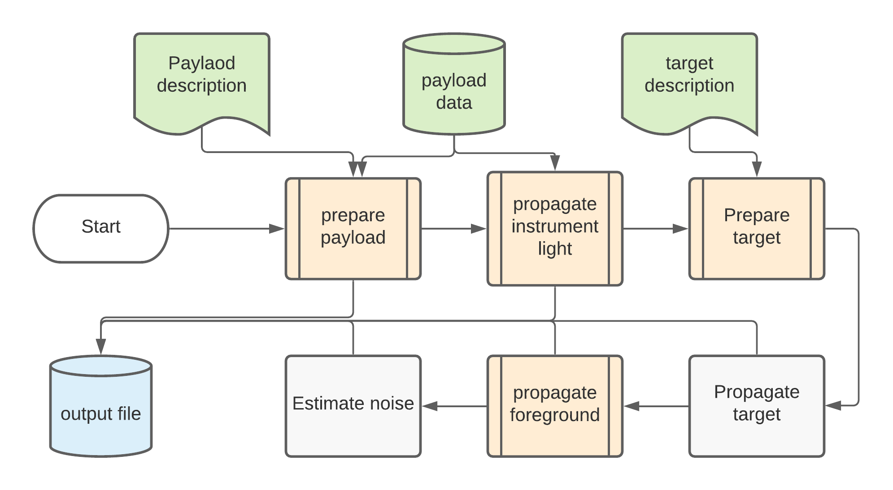

.. _introduction:

============
Introduction
============

Overview
========

ExoRad 2 is a generic **point-source radiometric model**. Given a target and an
instrument description it estimates the observation performance: the signal
collected from the star and from every diffuse background, the detector timing,
the photometric apertures, the wavelength bins, and the full noise budget. It
does not simulate the time-domain focal plane — for that, use
`ExoSim 2 <https://exosim2-public.readthedocs.io/>`__, which uses ExoRad as its
radiometric core.

Key concepts
============

Task-based architecture
-----------------------

Every step of the pipeline is a :class:`~exorad.tasks.task.Task`. Calling a
task validates its keyword inputs, fills in defaults, runs, and returns an
output. Tasks can be composed into different workflows, tested in isolation,
and replaced without touching the rest of the code. The main ones:

- :class:`~exorad.tasks.loadOptions.LoadOptions` — parse the payload XML;
- :class:`~exorad.tasks.instrumentHandler.PreparePayload` — build the
  instrument model;
- :class:`~exorad.tasks.targetHandler.LoadTargetList` — read the target list;
- :class:`~exorad.tasks.loadSource.LoadSource` — attach the stellar SED;
- :class:`~exorad.tasks.foregroundHandler.EstimateForegrounds` — build the
  diffuse radiances;
- :class:`~exorad.tasks.propagateLight.PropagateTargetLight` and
  :class:`~exorad.tasks.propagateLight.PropagateForegroundLight` — propagate
  the light to the detector;
- :class:`~exorad.tasks.noiseHandler.EstimateNoise` — the noise budget.

:class:`~exorad.tasks.targetHandler.ObserveTarget` chains these for one target;
:class:`~exorad.tasks.targetHandler.ObserveTargetlist` iterates over a whole
list, optionally in parallel.

Point-source model
------------------

All targets are treated as **point sources**, unresolved by the instrument — a
good approximation for stars (including transit hosts), distant galaxies and
other compact objects. The PSF sets how the point-source flux spreads over the
pixels; the geometry of an extended object is not modelled.

Units everywhere
----------------

Numerical values with a ``unit`` attribute in the payload file become
:class:`astropy.units.Quantity` objects and units are carried through the whole
calculation. Keep them consistent when editing configuration files.

The simulation workflow
=======================

Load and build the payload
--------------------------

:class:`~exorad.tasks.instrumentHandler.PreparePayload` reads the payload
description — an XML file parsed by
:class:`~exorad.tasks.loadOptions.LoadOptions`, or an ``.h5`` file with an
already-built payload. For an XML file it runs
:class:`~exorad.tasks.instrumentHandler.BuildChannels`, which builds each
:class:`~exorad.models.instruments.photometer.Photometer` or
:class:`~exorad.models.instruments.spectrometer.Spectrometer`: the wavelength bins, the
optical-path transmission, the instrument self-emission and the pixel response.
The built payload can be written to the output file and reloaded later. See
:ref:`prepare_payload` and :ref:`prepare_optics`.

Load the target list
--------------------

:class:`~exorad.tasks.targetHandler.LoadTargetList` reads the
:ref:`target list <targetlist>` — the stellar parameters (mass, effective
temperature, radius, distance) and, optionally, sky coordinates. See
:ref:`prepare_target`.

Prepare the source SED
----------------------

For every target, :class:`~exorad.tasks.loadSource.LoadSource` builds the
stellar spectral energy distribution: a Planck black body, the best-matching
BT-Settl PHOENIX spectrum, or a user-supplied SED (:ref:`prepare_target`).

Estimate and propagate the foregrounds
--------------------------------------

:class:`~exorad.tasks.foregroundHandler.EstimateForegrounds` builds the
zodiacal and custom sky radiances on the common wavelength grid;
:class:`~exorad.tasks.propagateLight.PropagateForegroundLight` propagates each
to the detector (:ref:`foregrounds`).

Propagate the target light
--------------------------

:class:`~exorad.tasks.propagateLight.PropagateTargetLight` integrates the
stellar SED through the optical transmission and the quantum efficiency to a
photo-electron rate, then scales it to the photometric aperture
(:ref:`estimate_signal`).

Estimate the noise
------------------

:class:`~exorad.tasks.noiseHandler.EstimateNoise` computes the detector timing
(:ref:`timing_model`), the :ref:`multiaccum` gains, the photon noise of every
signal, the dark-current and read noise, and combines them into ``total_noise``
(:ref:`total_noise`). Custom noise sources from the payload file are added last.

Save the results
----------------

Everything is written to a single HDF5 file: the parsed payload, the built
instrument, and one radiometric table per target. See :ref:`outputs`.

Core data structures
====================

:class:`~exorad.models.signal.Signal`
   A wavelength-dependent quantity: a wavelength grid, a data array (1-D, or
   2-D for a time-dependent signal) and unit-aware rebinning. The subclasses
   fix the data unit — :class:`~exorad.models.signal.Sed`
   (:math:`W\,m^{-2}\,\mu m^{-1}`),
   :class:`~exorad.models.signal.Radiance` (per steradian),
   :class:`~exorad.models.signal.CountsPerSeconds`.

:class:`~exorad.models.instruments.instrument.Instrument`
   The base of :class:`~exorad.models.instruments.photometer.Photometer` and
   :class:`~exorad.models.instruments.spectrometer.Spectrometer`. Each holds its output
   :class:`astropy.table.QTable`, a ``built_instr`` dictionary of cached
   quantities, and an :class:`~exorad.models.optics.opticalPath.OpticalPath`.

:class:`~exorad.models.target.Target`
   Carries the star, the foreground models and, after the run, the radiometric
   table. Its attributes are attached by the pipeline tasks.

Configuration files
===================

Payload description (XML)
-------------------------

.. code-block:: xml

   <root>
       <ConfigPath> /path/to/checkout </ConfigPath>

       <common>
           <wl_min unit="micron"> 0.5 </wl_min>
           <wl_max unit="micron"> 1.0 </wl_max>
           <sourceSpectrum> planck </sourceSpectrum>
       </common>

       <optics>
           <!-- shared telescope optics -->
       </optics>

       <channel> Spec
           <channelClass> Spectrometer </channelClass>
           <wl_min unit="micron"> 0.5 </wl_min>
           <wl_max unit="micron"> 1.0 </wl_max>
           <detector> <!-- ... --> </detector>
           <optics>   <!-- channel-specific optics --> </optics>
       </channel>
   </root>

Full details in :ref:`prepare_payload`.

Target list (CSV)
-----------------

A comma-separated file; the unit is part of the column name:

.. code-block:: text

   star name,star M [M_sun],star Teff [K],star R [R_sun],star D [pc],star magk
   MyStar,1.0,5778,1.0,10.0,5.0

Optional ``star ra [deg]`` / ``star dec [deg]`` columns feed the
position-dependent zodiacal model. A planet section can be added with
``planet <field> [<unit>]`` columns.

Best practices
==============

- **Reuse built payloads.** Write the built instrument to HDF5 once and reload
  it for many target lists.
- **Parallelise.** The ``-n`` flag runs targets concurrently.
- **Tune the SED grid.** ``<working_R>`` in the ``<common>`` section (default
  6000) trades accuracy for speed.
- **Start from the examples.** ``examples/payload_example.xml`` and
  ``examples/test_target.csv`` are a complete, working configuration.

Glossary
========

.. glossary::

   Channel
      One photometric or spectroscopic detector system.

   Frame time
      The detector readout cadence: an explicit ``frame_time``, or a fraction
      ``f_well_depth`` of the shortest saturation time in the channel.

   Multiaccum
      Fitting a ramp of non-destructive reads instead of a single CDS pair, to
      reduce the read-noise contribution.

   PCE
      Photon conversion efficiency: the product of the optical transmission and
      the quantum efficiency.

   Point source
      An object unresolved by the instrument.

   QE
      Quantum efficiency: the fraction of incident photons converted to
      photo-electrons.

   SED
      Spectral energy distribution: flux as a function of wavelength.

   Well depth
      The maximum charge a pixel can hold before it saturates.

References
==========

Mugnai et al., 2023, "ExoRad 2.0: The generic point source radiometric model".
*Journal of Open Source Software*, 8(89), 5348.
`doi:10.21105/joss.05348 <https://doi.org/10.21105/joss.05348>`__
