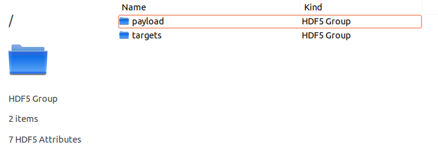
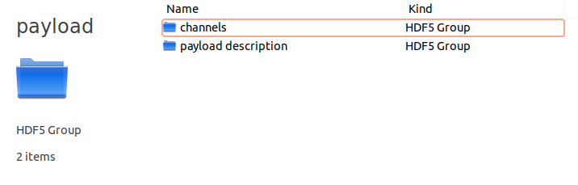
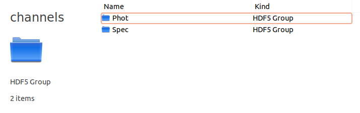
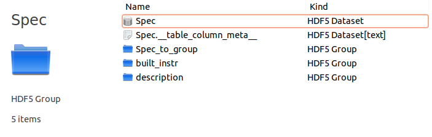
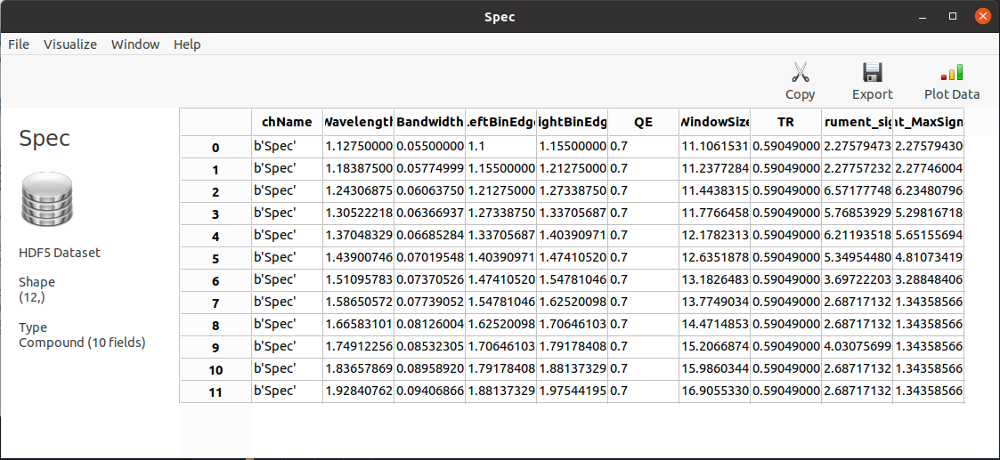
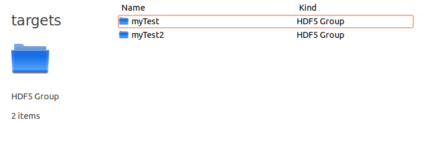
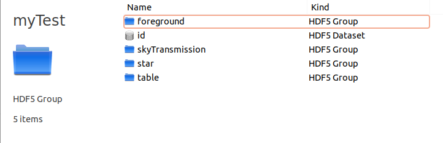
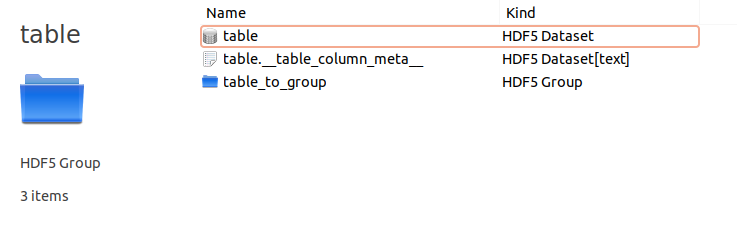

.. _outputs:

=========================
Understanding the outputs
=========================

The output is a single HDF5_ file, readable with viewers such as HDFView_ and
HDFCompass_ and with the h5py_ Python API. This page describes its layout and
every column of the two tables ExoRad produces.

At the top level there are three groups: ``info`` (the file metadata and the
package version), ``payload`` (the built instrument) and ``targets`` (the
results).

The ``payload`` group
=====================

.. _payload-output:

``payload`` holds a ``channels`` group and a ``payload description`` group with
the parsed XML.

Each channel group (``Phot``, ``Spec`` in the example) contains:

- a dataset named after the channel — the channel table — plus a text dataset
  ``<channel>.__table_column_meta__`` with its metadata. Load the pair back
  into a :class:`astropy.table.QTable` with :func:`~exorad.output.hdf5.hdf5.load`;
- a ``<channel>_to_group`` group, the same table stored as a nested dictionary;
- a ``description`` group, the channel's slice of the payload XML;
- a ``built_instr`` group, the processed data that lets ExoRad reload a built
  channel without rebuilding it.

The channel table
-----------------

One row per spectral bin (a single row for a photometer):

.. list-table::
   :header-rows: 1
   :widths: 30 70

   * - Column
     - Description
   * - ``chName``
     - the channel name, repeated on every row
   * - ``Wavelength``
     - bin centre
   * - ``Bandwidth``
     - bin width
   * - ``LeftBinEdge`` / ``RightBinEdge``
     - bin edges
   * - ``QE``
     - detector quantum efficiency in the bin
   * - ``TR``
     - end-to-end optical transmission of the channel in the bin
   * - ``WindowSize``
     - photometric window, in pixels (:ref:`estimate_apertures`)
   * - ``instrument_signal``
     - telescope self-emission signal in the bin, in ct/s
       (:ref:`estimate_signal`)
   * - ``instrument_MaxSignal_inPixel``
     - its peak per-pixel rate, in ct/s

The ``targets`` group
=====================

.. _target-output:

One group per target, named after it.

Inside a target group:

- ``star`` — the stellar model and SED;
- ``foreground`` — each diffuse source;
- ``skyTransmission`` — the combined transmission of all the foregrounds;
- ``table`` — the radiometric results.

The target table
----------------

One row per spectral bin. The first columns repeat the channel table; the rest
are the propagated signals and the noise budget.

.. list-table::
   :header-rows: 1
   :widths: 32 68

   * - Column
     - Description
   * - ``chName`` … ``instrument_MaxSignal_inPixel``
     - as in the channel table above
   * - ``<name>_signal``
     - signal of a diffuse foreground in the bin, in ct/s — for the example
       payload ``skyFilter_signal`` and ``zodi_signal``
       (:ref:`foregrounds`)
   * - ``<name>_MaxSignal_inPixel``
     - its peak per-pixel rate, in ct/s
   * - ``foreground_transmission``
     - the transmission of everything in front of the telescope (the channel
       optics are already in ``TR``)
   * - ``starFlux``
     - stellar flux integrated over the bin, in :math:`W\,m^{-2}`
   * - ``starSignal``
     - total stellar signal collected by the telescope, in ct/s
   * - ``star_signal_inAperture``
     - stellar signal inside the photometric aperture, in ct/s — the
       :ref:`total noise <total_noise>` is normalised against this
   * - ``star_MaxSignal_inPixel``
     - peak stellar rate in a pixel, in ct/s
   * - ``MaxSignal_inPixel``
     - the peak per-pixel rate summed over the star and every foreground (the
       most illuminated pixel is the same for all, since they share the PSF)
   * - ``saturation_time``
     - time for that pixel to fill the well, in s (:ref:`timing_model`)
   * - ``frameTime``
     - the frame time, in s (:ref:`timing_model`)
   * - ``<signal>_noise``
     - photon noise of each signal — ``instrument_signal_noise``,
       ``skyFilter_signal_noise``, ``zodi_signal_noise``,
       ``star_signal_inAperture_noise`` — in :math:`ct\,s^{-1}\sqrt{hr}`
       (:ref:`photon_noise`)
   * - ``darkcurrent_noise``
     - dark-current shot noise, in :math:`ct\,s^{-1}\sqrt{hr}`
       (:ref:`dark_current_noise`)
   * - ``read_noise``
     - detector read noise, in :math:`ct\,s^{-1}\sqrt{hr}` (:ref:`read_noise`)
   * - ``total_noise``
     - the combined noise, **relative**, in :math:`\sqrt{hr}`
       (:ref:`total_noise`)
   * - ``<name>_noise``
     - any :ref:`custom noise <custom_noise>` declared in the payload, e.g.
       ``gain_noise``

.. note::

   Every noise column is a **one-hour** value. For an integration of duration
   :math:`t`, multiply ``total_noise`` by :math:`\sqrt{t / 1\,\mathrm{hr}}` to
   get the fractional noise.

.. _HDF5: https://www.hdfgroup.org/solutions/hdf5/
.. _HDFView: https://www.hdfgroup.org/downloads/hdfview/
.. _HDFCompass: https://github.com/HDFGroup/hdf-compass
.. _h5py: https://www.h5py.org/
