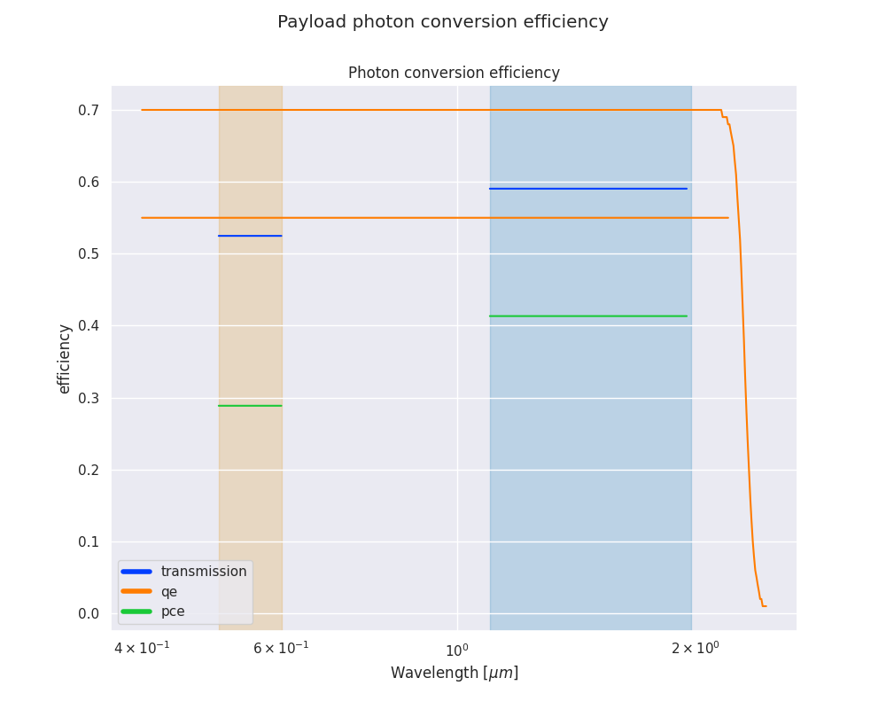
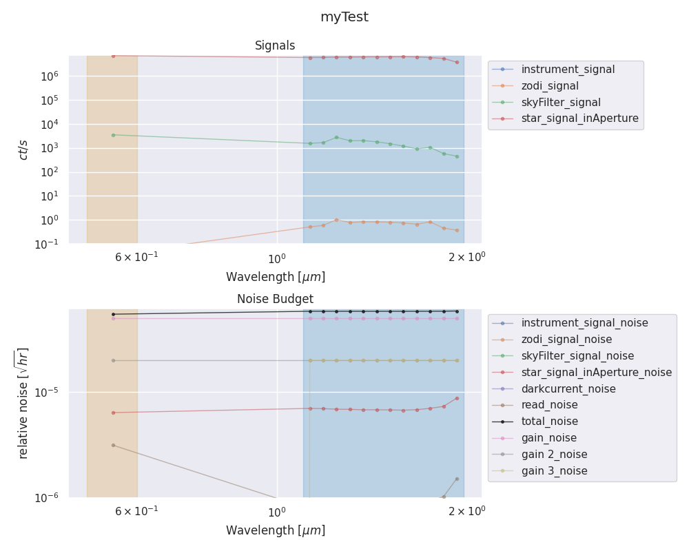

.. _quickstart_guide:

================
Quickstart guide
================

This is a first run with the example files shipped with ExoRad: the target list
``examples/test_target.csv`` and the payload description
``examples/payload_example.xml``.

The target list
===============

``examples/test_target.csv`` is a complete example of one of the supported
input formats — a comma-separated table with the target information ExoRad
needs. The example uses a star as the target, but ExoRad works with any point
source. It has a single target here; add rows to the CSV to run a whole list at
once.

The payload description file
============================

``examples/payload_example.xml`` is an XML file describing the payload. The
example exercises most of the options ExoRad supports; each is covered in its
own page of this guide.

Before running, set the ``ConfigPath`` value near the top of the file to your
ExoRad checkout — it tells ExoRad where to find the payload data files:

.. code-block:: xml

   <ConfigPath> /your_path/ExoRad
       <comment> Main directory for the configuration files </comment>
   </ConfigPath>

Your first run
==============

From the checkout directory:

.. code-block:: console

   exorad -t examples/test_target.csv -p examples/payload_example.xml -o examples/first_run.h5

ExoRad analyses ``test_target.csv`` with the ``payload_example.xml`` payload and
writes the results to ``examples/first_run.h5``, alongside a copy of the two
input files for reproducibility.

Run ``exorad --help`` for the full list of flags. The most useful ones:

.. list-table::
   :header-rows: 1
   :widths: 22 78

   * - Flag
     - Description
   * - ``-p``, ``--payload``
     - input payload description file
   * - ``-t``, ``--targetList``
     - input target list file
   * - ``-o``, ``--output``
     - output HDF5 file
   * - ``-c``, ``--full_contrib``
     - keep every contribution to the signal in the output
   * - ``-P``, ``--plot``
     - save diagnostic plots
   * - ``-n``, ``--nThreads``
     - number of threads for parallel processing
   * - ``-d``, ``--debug``
     - log to the screen
   * - ``-l``, ``--log``
     - also write the log to a file

Producing some plots
====================

Add ``-P`` to save diagnostic plots — one PNG per target plus one for the
instrument efficiency:

.. code-block:: console

   exorad -t examples/test_target.csv -p examples/payload_example.xml -o examples/first_run.h5 -P

The efficiency plot shows, over the simulated wavelength range, the detector
quantum efficiency, the optical transmission and the resulting photon
conversion efficiency.

The per-target plot has one panel for the signal (contributions below
:math:`10^{-3}` clipped) and one for the noise budget (contributions below
:math:`10^{-7}` clipped).

You can also re-plot an existing output file with ``exorad-plot``:

.. code-block:: console

   exorad-plot -i examples/first_run.h5 -o examples/plots

``exorad-plot`` accepts a range or a list of target indices, or a target name:

.. code-block:: console

   exorad-plot -i examples/first_run.h5 -o examples/plots -n 0          # the first target
   exorad-plot -i examples/first_run.h5 -o examples/plots -n 0:1        # a range
   exorad-plot -i examples/first_run.h5 -o examples/plots -n 1,2,50     # a list
   exorad-plot -i examples/first_run.h5 -o examples/plots -t myTest     # by name
